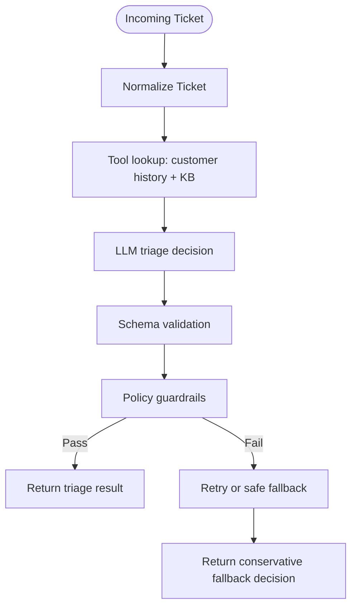

# Support Triage Agent

[](https://github.com/godman32770/SupportTicket-TriageAgent/actions/workflows/pytest.yml)

A production-friendly support triage agent with deterministic guardrails, strict JSON schema validation, live/offline LLM support, telemetry, redaction, evaluation tooling, and a JSON-first CLI.

## Table of contents

- [Overview](#overview)
- [Features](#features)
- [Installation](#installation)
- [Running the CLI](#running-the-cli)
- [Architecture overview](#architecture-overview)
- [Requirement coverage](#requirement-coverage)
- [Guardrails](#guardrails)
- [Testing](#testing)
- [GitHub Actions](#github-actions)
- [Evaluation](#evaluation)
- [Limitations](#limitations)
- [Telemetry and privacy](#telemetry-and-privacy)
- [Docker](#docker)
- [Command reference](#command-reference)
- [Project structure](#project-structure)
- [Workflow diagram](#workflow-diagram)
- [Notes](#notes)

## Overview

This project is a safe AI customer support triage workflow designed to analyze incoming support tickets, extract structured metadata, consult customer history and a KB, and make a conservative decision about whether to auto-respond, route to a specialist, or escalate to a human.

It is intentionally policy-checked and deterministic: the model can suggest a decision, but the final output must pass rigid validation and guardrail checks before it is returned.

## Features

- Accepts support tickets as JSON from a file or a structured Python payload
- Classifies urgency as low, medium, high, or critical
- Extracts structured metadata: product, issue type, sentiment, language, and intents
- Uses customer-history and knowledge-base tools before making a decision
- Applies deterministic policy guardrails before accepting any output
- Validates model output against a strict JSON schema
- Supports both live OpenAI mode and offline/mock mode for CI and testing
- Falls back safely when tooling, parsing, LLM output, or policy checks fail
- Includes evaluation scripts and unit tests for quality and reliability
- Adds PII redaction and lightweight telemetry for production-minded logging
- Includes stronger benchmark-style eval fixtures and policy mapping for realistic safety review

## Installation

1. Clone or open the project directory.
2. Create and activate a virtual environment (optional but recommended):

   Windows PowerShell:
   ```powershell
   python -m venv .venv
   .\.venv\Scripts\Activate.ps1
   ```

   macOS/Linux:
   ```bash
   python3 -m venv .venv
   source .venv/bin/activate
   ```

3. Install the app and development dependencies:

   ```bash
   python -m pip install --upgrade pip
   python -m pip install -e .
   python -m pip install pytest
   ```

4. Optional: set a live OpenAI key for `--mode live`:

   PowerShell:
   ```powershell
   $env:OPENAI_API_KEY = "your-key-here"
   ```

   macOS/Linux:
   ```bash
   export OPENAI_API_KEY=your-key-here
   ```

## Running the CLI

Run triage from the project root. Example quick run in offline mode:

```bash
python -m app.cli.main --ticket-file tickets/sample_ticket.json --mode offline --pretty
```

Example output (offline mode):

```json
{
  "ticket_id": "T-100",
  "urgency": "high",
  "product": "mobile_app",
  "issue_type": "login",
  "sentiment": "frustrated",
  "language": "en",
  "intents": ["login_help"],
  "action": "escalate_to_human",
  "confidence": 0.9,
  "customer_history_summary": "Customer C-100 previously reported: Previous order issue resolved after replacement shipment.; Customer is generally positive but became frustrated after a billing delay.",
  "kb_summary": "Password reset flows are available; if MFA issues persist, escalate to specialist."
}
```

The CLI also emits `reasoning` and `safety_checks`; those fields are shortened above for readability.

Flags:

- `--ticket-file` path to a JSON support ticket file
- `--mode offline` uses the embedded deterministic mock
- `--mode live` uses OpenAI (requires API key)
- `--model` overrides the live model name
- `--pretty` pretty-prints the final JSON output

Additional offline examples:

```bash
python -m app.cli.main --ticket-file tickets/sample_ticket_free.json --mode offline --pretty
python -m app.cli.main --ticket-file tickets/sample_ticket_enterprise.json --mode offline --pretty
python -m app.cli.main --ticket-file tickets/sample_ticket_pro.json --mode offline --pretty
```

Batch validation workflow:

The CLI accepts either a single ticket object or a JSON array of ticket objects. Use category-specific batch files to validate the main triage paths.

```powershell
$env:OPENAI_API_KEY = "your-key-here"

python -m app.cli.main --ticket-file tickets/batch_login.json --mode live --pretty > live_login.json
python -m app.cli.main --ticket-file tickets/batch_billing.json --mode live --pretty > live_billing.json
python -m app.cli.main --ticket-file tickets/batch_outage.json --mode live --pretty > live_outage.json
python -m app.cli.main --ticket-file tickets/batch_security.json --mode live --pretty > live_security.json
python -m app.cli.main --ticket-file tickets/batch_prompt.json --mode live --pretty > live_prompt.json
```

Then compare the live outputs against the bundled gold benchmark:

```bash
python eval/run_eval.py --file eval/sample_eval.json --mode live --model gpt-4o-mini
```

Offline benchmark command:

```bash
python eval/run_eval.py --file eval/sample_eval.json --mode offline
```

The bundled 15-ticket fixture is a smoke benchmark for CI. The larger 30-ticket fixture is the more useful offline stress test:

```bash
python -m eval.run_eval --file eval/benchmark_30.json --mode offline --no-write
```

Assignment-origin sample run:

```bash
make eval-assignment
python -m eval.run_eval --file eval/assignment_origin_eval.json --mode live --model gpt-4o-mini
```

`eval/assignment_origin_eval.json` contains the three supplied Enterprise, Free, and Pro tickets from `tickets/sample_ticket_enterprise.json`, `tickets/sample_ticket_free.json`, and `tickets/sample_ticket_pro.json`. Their source intents are preserved on each ticket; the `gold` section maps them to this project’s canonical taxonomy.

The assignment-origin fixture is intentionally separate from the synthetic benchmark. It checks the three supplied examples, but it is too small to support a general accuracy claim.

## Architecture overview

The app is split into clear responsibilities:

- `app/models/` defines structured ticket and triage output objects and the JSON schema
- `app/tools/` contains read-only customer history, knowledge-base, and configurable service-status lookups; KB lookup first uses structured fields and then falls back to ticket-description terms
- `app/llm/` contains the live OpenAI adapter and the deterministic offline mock
- `app/guardrails/` contains the policy guardrail checks used before accepting a model response
- `app/agent/` contains the orchestrator loop and fallback logic
- `app/cli/` contains the JSON CLI entry point
- `app/telemetry/` contains redaction and basic metrics collection
- `eval/` contains evaluation fixtures and scoring scripts
- `tests/` covers tool calls, guardrails, parsing, fallback, and CLI behavior

This keeps the project easy to extend while preserving a conservative, production-oriented decision pipeline.

## Requirement coverage

| Requirement | Where it is implemented |
|---|---|
| JSON CLI intake | `app/cli/main.py` |
| Urgency classification | `app/models/triage.py`, `app/agent/triage_agent.py` |
| Structured extraction (product, issue type, sentiment, language, intents) | `app/models/triage.py`, `app/llm/client.py` |
| Customer history + KB + service status tools | `app/tools/`, `app/agent/triage_agent.py` |
| Action decision: auto_respond / route_to_specialist / escalate_to_human | `app/agent/triage_agent.py`, `app/guardrails/policy.py` |
| Deterministic safety guardrails | `app/guardrails/policy.py` |
| Strict JSON schema validation | `app/models/triage.py` |
| Fallback handling for failures and invalid outputs | `app/agent/triage_agent.py` |
| Live and offline LLM modes | `app/llm/client.py` |
| Eval scripts and metrics | `eval/run_eval.py`, `app/eval/metrics.py` |
| Unit tests | `tests/` |
| Clean typed structure | Package layout under `app/` |

## Guardrails

| Guardrail ID | Trigger condition | Action when activated | Notes |
|---|---|---|---|
| billing_no_auto | Billing dispute, chargeback, unresolved payment, or invoice issue is present | Prevent auto_respond; route or escalate | Protects against financial/legal misclassification |
| enterprise_outage_escalate | Enterprise customer + outage/down/service unavailable | Force `escalate_to_human` and critical urgency | High-impact customer outage policy |
| sec_escalate | Security, breach, data loss, legal threat, or lawsuit signal | Prevent auto_respond, set urgency >= high | Security/legal cases are human-first |
| prompt_injection_escalate | Instruction bypass, prompt injection, malicious behavior, or override attempts | Discard draft and escalate | Treat as risky input |
| no_promises | Refund, compensation, ETA, or commitment language appears in the proposed draft or response | Hold or replace auto draft | Avoid unauthorized promises |
| draft_language_matches | Draft language does not match ticket language | Replace or human-review the draft | Keeps responses linguistically safe |
| ungrounded_auto_respond | Auto decision attempted without KB evidence or KB has no match | Prevent auto_respond; route to specialist | Ensures factual grounding |
| low_confidence_escalate | Confidence falls below the configured threshold | Prevent auto_respond; route or escalate | Keeps low-confidence replies safe |
| action_matches_intents | Requested intent or context already implies escalation or specialist handling | Prevent unsafe auto action | Intent-based override |

Notes:

- Guardrails are conservative by design and intentionally prioritize safety over convenience.
- The policy logic lives in `app/guardrails/policy.py` and is covered by tests in `tests/`.
- The action is always chosen from the allowed set: `auto_respond`, `route_to_specialist`, or `escalate_to_human`.

## Testing

Run the full suite:

```bash
python -m pytest -q
```

Run a specific file:

```bash
python -m pytest tests/test_guardrails.py -q
```

## GitHub Actions

This repository includes CI at `.github/workflows/pytest.yml`. It runs pytest, Ruff, mypy, and the critical-case evaluation gate:

```yaml
name: pytest

on:
  push:
    branches: [main, master]
  pull_request:

jobs:
  test:
    runs-on: ubuntu-latest
    steps:
      - uses: actions/checkout@v4
      - uses: actions/setup-python@v5
        with:
          python-version: '3.11'
      - run: python -m pip install -e ".[dev]"
      - run: python -m pytest -q
      - run: python -m ruff check app eval tests
      - run: python -m mypy --strict app
      - run: python -m eval.run_eval --file eval/sample_eval.json --mode offline --fail-on-critical --no-write
```

## Evaluation

The eval runner can compare gold labels against either:

1. a precomputed predictions list, or
2. actual agent outputs generated from a `tickets` list using the live/offline triage agent

Example using the bundled fixture:

```bash
python -m eval.run_eval --file eval/sample_eval.json --mode offline
```

Offline sample benchmark (15 tickets; generated by `python -m eval.run_eval --file eval/sample_eval.json --mode offline`):

| Metric | Value |
|---|---:|
| urgency_accuracy | 0.87 |
| action_accuracy | 0.87 |
| overall_accuracy | 0.87 |
| fallback_rate | 0.13 |
| kb_grounding_rate | 1.00 |
| product_accuracy | 1.00 |
| issue_type_accuracy | 1.00 |
| sentiment_accuracy | 1.00 |
| language_accuracy | 1.00 |
| intents_accuracy | 1.00 |
| kb_hit_rate | 0.47 |
| safety_policy_pass_rate | 1.00 |

The 30-ticket fixture gives a less optimistic view. The majority-class baseline always predicts `low` urgency and `escalate_to_human` action. Live results are reported separately because they require an API key, incur cost, and vary by model and run.

| Evaluation | N | Urgency accuracy | Action accuracy | Overall accuracy | Critical cases missed |
|---|---:|---:|---:|---:|---:|
| Majority baseline (30-ticket gold set) | 30 | 0.33 | 0.40 | 0.33 | 7 |
| Offline deterministic mock (15-ticket smoke set) | 15 | 0.87 | 0.87 | 0.87 | 0 |
| Offline deterministic mock (30-ticket benchmark) | 30 | 0.83 | 0.80 | 0.70 | 0 |
| Live `gpt-4o-mini` (2026-10-22 saved run) | 30 | 0.53 | 0.70 | 0.47 | 1 |

The saved 30-ticket live run measured 0.92 escalation recall, 0.07 fallback rate, 5,644 ms latency p50, 10,902 ms p95, 4 model calls per ticket at p50, and approximately $1.71 projected cost per 10,000 tickets. It is one model/date snapshot, not a benchmark guarantee. The complete per-case result is saved at `eval/results/benchmark_30-gpt-4o-mini-2026-10-22.json`.

### Assignment-origin live versus offline

The offline run is deterministic and the live run was executed with the latest code using the three supplied assignment tickets. The fresh live result is saved at `eval/results/assignment_origin_eval-gpt-4o-mini-2026-10-22.json`.

| Run | N | Urgency | Action | Overall* | Critical missed | Fallback | Metadata fields** |
|---|---:|---:|---:|---:|---:|---:|---:|
| Assignment-origin offline, current code | 3 | 1.00 | 1.00 | 1.00 | 0 | 0.00 | 1.00 |
| Assignment-origin live `gpt-4o-mini`, fresh 2026-10-22 run | 3 | 1.00 | 1.00 | 1.00 | 0 | 0.00 | 1.00 |

\* `overall_accuracy` is the runner's urgency/action pair metric; it does not include metadata fields.

\*\* Mean of product, issue type, sentiment, language, and intent accuracy. The fresh live rerun scored 1.00 on all five fields.

Both modes now score 1.00 on the three assignment-origin cases, with zero fallback and zero missed critical cases. This is strong evidence that the latest orchestration and metadata guardrails fixed the observed sample failures, but the sample is still too small to support a broad production accuracy claim.

Live mode is a single command. Copy `.env.example` to `.env`, set a valid key, and run:

```bash
make demo-live
```

The command uses native OpenAI tool calls (`get_customer_history`, `search_kb`, `check_service_status`, and the forced final `submit_triage` call) and prints latency plus prompt/completion/total token counts. Live evaluation writes the expected labels and actual outputs to `eval/results/<fixture>-<model>-<date>.json`; including the fixture name prevents benchmark and assignment runs from overwriting each other. Live results depend on the configured model, quota, and API response at run time, so repeat runs should be treated as separate measurements.

Metrics returned include:

- `urgency_accuracy`
- `action_accuracy`
- `overall_accuracy`
- `fallback_rate`
- `product_accuracy`
- `issue_type_accuracy`
- `sentiment_accuracy`
- `language_accuracy`
- `intents_accuracy`
- `kb_grounding_rate`
- `safety_policy_pass_rate`
- optional latency and tool-success summaries when present

Important note: the offline mock is intentionally rule-based and tuned to the sample benchmark. It is useful for deterministic CI and guardrail checks, but it is not a production-grade evaluator. The score only becomes meaningful once you replace the mock with a realistic benchmark corpus and live validation workflow.

### Retry and tool-call bounds

The live model may choose whether to request one of the registered tools, but the outer agent enforces a bounded loop. By default, each ticket allows at most three tool calls (each registered tool once) and two outer model retries after a parse, schema, policy, or tool failure. The live OpenAI adapter adds two request retries for transient API failures, with exponential backoff capped at eight seconds. Once a bound is reached, the agent returns a deterministic human-escalation fallback. These limits are configurable through `TriageAgent(max_model_retries=..., max_tool_calls=...)` and `OpenAIChatClient(max_retries=...)`.

For live outage verification, set `SERVICE_STATUS_URL` to an operator-controlled JSON status endpoint. The endpoint should return an object containing `status`, `indicator`, or `state`; without that variable, the tool reports that no platform-wide incident is confirmed and content-based safety rules still take priority.

## Design, operations, and rollout (summary)

The custom orchestration loop is deliberately small: it makes tool order, validation, retries, audit events, and safe fallback behavior explicit without introducing framework-specific state. `gpt-4o-mini` is the default because it is a low-cost, low-latency model suitable for structured support routing; model and per-token prices are configurable through `MODEL_NAME`, `OPENAI_INPUT_COST_PER_MILLION`, and `OPENAI_OUTPUT_COST_PER_MILLION`. Guardrails remain code-based because prompts can be ignored, tool output is untrusted, and policy decisions must be deterministic and testable.

The current assignment-origin offline run reports 1.00 escalation recall, 1.00 intent accuracy, 3 LLM-loop calls per ticket at p50, and $0 offline cost. Latency is machine-dependent (this run measured 8.7 ms p50 and 9.05 ms p95). Live runs record `usage.prompt_tokens`, `usage.completion_tokens`, calculated cost, and a 10,000-ticket/day projection in `eval/results/`; live cost is intentionally environment/model dependent.

Known limitations include keyword-based policy matching, which can miss unusual phrasing, and uncalibrated model confidence scores. The next calibration step is to fit confidence against a held-out labeled set and only enable auto-response for categories whose measured precision exceeds 99% with no critical-case misses.

Production rollout starts in shadow mode with human approval. Human corrections become labeled examples with the original ticket, model output, corrected action/urgency, and reason; they are split by time/customer to avoid leakage. Promotion requires the precision threshold above, complete critical-case recall, and stable p95 latency/cost. Monitor escalation recall, action precision, fallback rate, tool success, schema/policy failures, p50/p95 latency, tokens, cost, and disagreement rate. During development, live tool invocation initially failed because JSON response formatting competed with tool calls; replacing it with native tools and a forced final `submit_triage` call resolved that failure.

## Limitations

- The offline mock is rule-based and tuned to a small sample set; it is not a real production benchmark.
- The eval set is small, human-reviewed data is still missing, and a larger benchmark is needed for confidence.
- Live mode is subject to OpenAI cost and model drift, so budget caps and dataset versioning matter.
- `fallback_rate` is an important safety metric because it catches policy failures that a high `safety_policy_pass_rate` can hide.
- The agent loop is intentionally bounded orchestration: the live model chooses whether to request a registered tool, but it cannot invent tools or run indefinitely. This improves auditability and safety at the cost of less open-ended agent behavior.
- The benchmark labels are illustrative and not independently validated. The 30-ticket result is too small for a production claim, and the checked-in live score is only one model/date snapshot.
- The majority baseline is only a reference point; the next evaluation step is a held-out, human-reviewed set with repeated live runs and error analysis by category.
- The 30-ticket benchmark and 15-ticket smoke set are synthetic fixtures; the separate assignment-origin fixture uses the three supplied sample tickets but its canonical labels are still project annotations, not independently audited ground truth.
- The saved 2026-10-22 live result predates the latest persistent-message and content-override changes; rerun the live benchmark before treating it as the final post-fix model measurement.

## Telemetry and privacy

This project includes lightweight telemetry and PII redaction to support safer production usage:

- `app/telemetry/redaction.py` removes or masks email/phone-style information before logging or eval output
- `app/telemetry/metrics.py` records basic decisions, errors, and fallback events
- Safe fallback and model/tool failures are logged without exposing raw sensitive data

This is a foundational step toward responsible production operations. Real-world deployments should also consider export sinks, retention policies, and cost budgets for live LLM usage.

## Docker

There is a Dockerfile and a docker-compose.yml for containerized runs.

Build the image:

```bash
docker build -t support-triage-agent .
```

Run offline (mount tickets folder):

```bash
docker run --rm -v "${PWD}/tickets:/app/tickets:ro" support-triage-agent --ticket-file /app/tickets/sample_ticket.json --mode offline
```

Run live (with API key):

```bash
docker run --rm -e OPENAI_API_KEY=$OPENAI_API_KEY -v "${PWD}/tickets:/app/tickets:ro" support-triage-agent --ticket-file /app/tickets/sample_ticket.json --mode live
```

Compose quick start:

```bash
docker compose up --build
```

Override compose command for ad-hoc runs:

```bash
docker compose run --rm triage -- --ticket-file /app/tickets/other_ticket.json --mode offline
```

## Command reference

| Command | What it does | Example |
|---|---|---|
| Run CLI (offline) | Run triage on a JSON ticket using the deterministic local mock | `python -m app.cli.main --ticket-file tickets/sample_ticket.json --mode offline --pretty` |
| Run CLI (live) | Run triage using OpenAI (requires OPENAI_API_KEY) | `python -m app.cli.main --ticket-file tickets/sample_ticket.json --mode live --pretty` |
| Install deps | Install package and test tools locally | `python -m pip install -e . && python -m pip install pytest` |
| Run tests | Execute the unit test suite | `python -m pytest -q` |
| Eval metrics | Compute quality metrics against gold labels | `python -m eval.run_eval --file eval/sample_eval.json --mode offline` |
| Docker build | Build the container image | `docker build -t support-triage-agent .` |
| Docker run (offline) | Run the image in offline mode | `docker run --rm -v "${PWD}/tickets:/app/tickets:ro" support-triage-agent --ticket-file /app/tickets/sample_ticket.json --mode offline` |
| Docker run (live) | Run the image in live mode | `docker run --rm -e OPENAI_API_KEY=$OPENAI_API_KEY -v "${PWD}/tickets:/app/tickets:ro" support-triage-agent --ticket-file /app/tickets/sample_ticket.json --mode live` |
| Docker Compose up | Build and run the default service | `docker compose up --build` |
| Docker Compose run | Run a one-off command inside the container | `docker compose run --rm triage -- --ticket-file /app/tickets/other_ticket.json --mode offline` |

## Project structure

```text
app/
  agent/
  cli/
  eval/
  guardrails/
  llm/
  models/
  prompts/
  telemetry/
  tools/

eval/
  run_eval.py
  sample_eval.json

tests/
```

## Workflow diagram



## Notes

- The agent loop is orchestration-based: it gathers tool context, then generates a structured decision, then validates that decision before returning it.
- Invalid JSON, invalid tool requests, generation failures, schema issues, and policy issues trigger retries and then a deterministic fallback.
- The CLI is intentionally read-only and does not directly reply to customers or trigger external workflows.
- Offline mode is ideal for CI, local testing, and reproducible evaluation.
- The project is designed to be easy to extend as more routing rules, risk policies, or tool integrations are added.

## Roadmap hardening summary

This project follows a conservative orchestration architecture instead of a full agent framework because the main requirement is reliable safety under real-world support traffic. We keep a small custom control loop (normalize ticket → tool context → LLM → schema validation → policy guardrails → fallback) because it gives us deterministic ordering, easier debugging, and clear points for retry/fallback logic. The trade-off is that it is less declarative than a framework-based workflow, but the safety and auditability gains are substantial for triage systems dealing with high-risk customer issues.

We also separate the concerns between the tool layer, LLM adapter, schema validator, and policy guardrail so the system can be extended without rewriting the entire pipeline. This is easier to reason about than a single monolithic prompt or a highly abstract agent framework when the application needs robust compliance behavior.

Benchmarks and evidence:

- Local deterministic suite: 53 tests passing (`pytest -q`)
- Guardrail and schema tests: included in the project suite
- Offline benchmark: deterministic mock and evaluation runner available via `eval/run_eval.py`
- Live benchmark: run `make demo-live` or `python -m eval.run_eval --file eval/benchmark_30.json --mode live`; each run records expected and actual outcomes plus latency and token usage under `eval/results/`.

Cost and latency notes:

- For a live OpenAI run, the code tracks the task flow and logs timestamps via telemetry. The exact cost per ticket depends on prompt length, context size, validation retries, and the model selected.
- The project uses `gpt-4o-mini` as the default live model because it offers a strong balance of quality, latency, and cost for a support-routing workflow. It is smaller and cheaper than larger reasoning models, while still handling structured extraction and compliance checking well.
- A rough daily estimate at 10,000 tickets/day depends on the chosen model, average token count, and retry rate. For a text-heavy enterprise support workload, cost can be sharply reduced with prompt caching, concise KB summaries, and a two-stage funnel: cheap initial filtering model → expert review only for riskier tickets.

Known limitations:

- The offline mock is intentionally deterministic and is not a real production benchmark.
- Live metrics remain environment-dependent and require a valid key, quota, and representative benchmark data.
- PII redaction is stronger than the original version, but production deployments should still apply policy-based redaction before model calls, not only at logging time.
- A larger, human-reviewed benchmark is still needed for strong public claims about accuracy and risk.

If one more week were available, the next priorities would be:

1. Add a richer human-reviewed benchmark with legal/security and Thai-language edge cases.
2. Measure cost and latency per ticket automatically in live mode and export daily summaries.
3. Add a prompt-caching and model-routing layer to reduce cost while preserving safety.
4. Expand the policy suite and property tests for more edge cases and fail-fast validation.
5. Add a reporting dashboard for live and offline benchmark comparisons by urgency/action and fallback rate.

## Future improvements

- Add a richer benchmark dataset with human-reviewed edge cases and legal/security examples
- Add a live-mode cost guardrail to cap tokens or budget before execution
- Add structured JSONL telemetry and a reporting layer for production monitoring
- Add more safety policy mapping and rule explanation for internal compliance reviews
- Expand KB grounding with semantic retrieval and reranking for higher-quality answers
- **Limitations:** Offline mode uses a deterministic mock LLM; live performance depends on model quality, KB coverage, and external tool availability.
