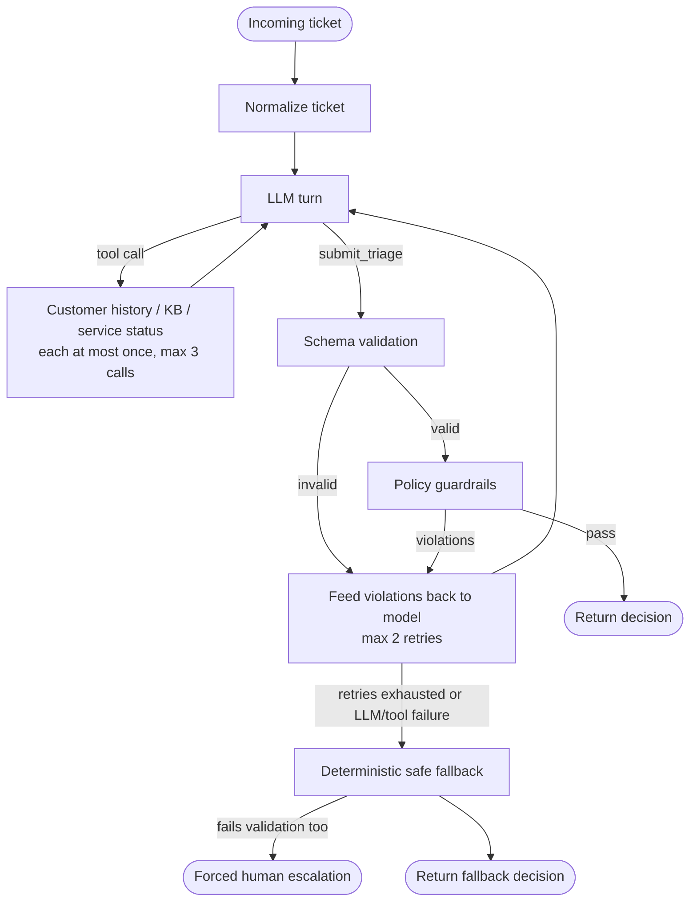

# Support Triage Agent

[](https://github.com/godman32770/SupportTicket-TriageAgent/actions/workflows/pytest.yml)

A conservative support-ticket triage agent. An LLM proposes a decision (urgency, metadata, and one of `auto_respond` / `route_to_specialist` / `escalate_to_human`); **deterministic code decides whether that proposal is allowed to leave the system.** Anything malformed, ungrounded, or risky is rejected and, after bounded retries, replaced by a safe human escalation.

**Design principle:** the model is untrusted. Prompts can be ignored and tool output can be hostile, so safety lives in code that is testable, not in the prompt.

## At a glance

| | |
|---|---|
| Input | JSON ticket (single object or array) via CLI or Python |
| Output | Validated JSON: urgency, product, issue type, sentiment, language, intents, action, confidence, final-decision summary, history/KB summaries, safety checks |
| Tools (read-only) | Customer history, knowledge base, service status |
| Modes | `offline` (deterministic mock, no key, used in CI) and `live` (OpenAI, native tool calls) |
| Safety | Strict schema validation + 10 policy guardrails + bounded retries + guaranteed fallback to human escalation |
| Quality gates (CI) | pytest, Ruff, `mypy --strict`, critical-case eval gate |
| Latest live result | `gpt-4o-mini`, 30-ticket benchmark: 0.97 urgency, 0.87 action, **0 high/critical cases not escalated**; held-out `newticket.json`: 0.50 / 0.55 / 0.40 urgency/action/overall (see [Results](#results)) |

## Table of contents

- [Quickstart](#quickstart)
- [How it works](#how-it-works)
- [Guardrails](#guardrails)
- [Results](#results)
- [Evaluation workflow](#evaluation-workflow)
- [Design decisions](#design-decisions)
- [Limitations](#limitations)
- [Production rollout plan](#production-rollout-plan)
- [Roadmap](#roadmap)
- [Testing and CI](#testing-and-ci)
- [Telemetry and privacy](#telemetry-and-privacy)
- [Docker](#docker)
- [Command reference](#command-reference)
- [Project structure](#project-structure)

## Quickstart

```bash
python -m venv .venv && source .venv/bin/activate      # Windows: .\.venv\Scripts\Activate.ps1
python -m pip install --upgrade pip
python -m pip install -e ".[dev]"

python -m app.cli.main --ticket-file tickets/sample_ticket.json --mode offline --pretty
```

Input (`tickets/sample_ticket.json`):

```json
{
  "ticket_id": "T-100",
  "customer_id": "C-100",
  "product": "mobile_app",
  "issue_type": "login",
  "description": "I cannot log in after password reset and it is urgent.",
  "language": "en",
  "sentiment": "frustrated"
}
```

Output (offline mode; `reasoning` and `safety_checks` are also emitted but trimmed here):

```json
{
  "ticket_id": "T-100",
  "urgency": "high",
  "product": "mobile_app",
  "issue_type": "login",
  "sentiment": "frustrated",
  "language": "en",
  "intents": ["login_help"],
  "action": "escalate_to_human",
  "confidence": 0.9,
  "customer_history_summary": "Customer C-100 previously reported: Previous order issue resolved after replacement shipment.; Customer is generally positive but became frustrated after a billing delay.",
  "kb_summary": "Password reset flows are available; if MFA issues persist, escalate to specialist."
}
```

The customer flags the issue as urgent, and the agent returns `high` urgency with `escalate_to_human` instead of auto-responding. Even if a model proposed `auto_respond` here, the `account_access_escalate` guardrail would reject it, because "cannot log in" is a covered phrasing (regression-tested).

**Live mode** (needs an OpenAI key):

```bash
cp .env.example .env        # set OPENAI_API_KEY
make demo-live              # runs live triage; prints latency and token counts
```

Other flags: `--model` overrides the live model, `--pretty` pretty-prints JSON. The CLI is read-only: it never replies to customers or triggers external workflows.

More sample tickets: `tickets/sample_ticket_{free,pro,enterprise}.json` and category batches `tickets/batch_{login,billing,outage,security,prompt}.json`.

## How it works



1. **Normalize** the ticket into a typed model.
2. **LLM loop.** The live model may request a registered tool (`get_customer_history`, `search_kb`, `check_service_status`) or submit its answer with the forced final `submit_triage` call. Each tool may be called once, with at most three calls per ticket; unknown or repeated tool requests are rejected.
3. **Validate.** Output must pass strict schema validation, then the policy guardrails. A violating decision is rejected and the violation text is returned to the model as feedback for the retry. In addition, deterministic calibration steps can adjust a decision before it is returned; these are recorded in `safety_checks` (for example `ungrounded auto-response rewritten`, `account access override applied`, `billing risk calibration applied`), so every override is auditable in the saved results. The application generates `reasoning` after these adjustments from the final urgency, intent, and action; model- or tool-authored explanations are not returned.
4. **Fall back.** On parse errors, schema or policy failures, tool failures, or exhausted retries the agent returns a deterministic, low-confidence `escalate_to_human` decision. If even that fails validation, it is replaced with a forced critical escalation.

Code map:

| Concern | Location |
|---|---|
| CLI intake | `app/cli/main.py` |
| Ticket and decision models, JSON schema | `app/models/` |
| Orchestrator loop, retries, fallback | `app/agent/triage_agent.py` |
| Tools (history, KB, service status) | `app/tools/` |
| Live OpenAI adapter and offline mock | `app/llm/client.py` |
| Policy guardrails | `app/guardrails/policy.py` |
| Redaction and metrics | `app/telemetry/` |
| Eval runner and metrics | `eval/run_eval.py`, `app/eval/metrics.py` |

Tool notes: KB lookup first uses structured fields (product, issue type) and then falls back to ticket-description terms. For live outage verification, set `SERVICE_STATUS_URL` to an operator-controlled JSON endpoint returning `status`, `indicator`, or `state`; without it, the tool reports that no platform-wide incident is confirmed, and content-based safety rules still take priority.

## Guardrails

Guardrails are conservative by design and prioritize safety over convenience. All live in `app/guardrails/policy.py` and are covered by `tests/test_guardrails.py`.

| ID | Triggered when | Decision is rejected unless |
|---|---|---|
| `account_access_escalate` | Locked out, cannot access, MFA code not working, or cannot / can't / unable to sign in, log in, or login | action is `escalate_to_human` |
| `billing_no_auto` | Billing dispute, chargeback, unresolved payment, or unpaid invoices (matched on ticket text, issue type, and customer history) | action is not `auto_respond` |
| `enterprise_outage_escalate` | Enterprise product plus outage / down / service unavailable | action is `escalate_to_human` **and** urgency is `critical` |
| `sec_escalate` | Security, breach, data loss, legal threat, or lawsuit signal | action is not `auto_respond`, and urgency is at least `high` or the action is `escalate_to_human` |
| `prompt_injection_escalate` | Instruction-bypass language, or a prompt-injection safety flag | action is not `auto_respond` |
| `no_promises` | Refund, compensation, or ETA language | action is not `auto_respond` |
| `draft_language_matches` | Draft language differs from ticket language | no `language_mismatch` flag is raised |
| `ungrounded_auto_respond` | `auto_respond` without KB evidence, or KB had no match | action is not `auto_respond` |
| `low_confidence_escalate` | Confidence below 0.75 | action is not `auto_respond` |
| `action_matches_intents` | Intents already imply human or specialist handling | action is not `auto_respond` |

Plus general rules: valid urgency and action values, required product/issue type, at least one intent, confidence in `[0, 1]`, and no `auto_respond` for `high` or `critical` urgency.

**Not covered yet:** privacy and data-exposure incidents (for example GDPR erasure requests or cross-tenant data exposure) and broad production-impact issues have no dedicated guardrail, which is the main cause of the held-out misses described in [Results](#results).

**Illustrative trace** (not a recorded run): the model proposes `auto_respond` for a ticket that mentions a chargeback. `billing_no_auto` returns a violation, the violation is fed back, and the model retries. If it still proposes an unsafe action after two retries, the deterministic fallback escalates to a human.

## Results

All numbers come from `python -m eval.run_eval`. Per-case results are written to `eval/results/<fixture>-<mode>-<model>-<date>.json`, so offline, live, benchmark, and assignment runs never overwrite each other.

| Evaluation | N | Urgency acc. | Action acc. | Overall acc. | High/critical not escalated |
|---|---:|---:|---:|---:|---:|
| Majority baseline (always `low` / `escalate_to_human`) | 30 | 0.33 | 0.40 | 0.33 | 7 |
| Offline mock, smoke set | 15 | 0.87 | 0.87 | 0.87 | 0 |
| Offline mock, 30-ticket benchmark (calibrated) | 30 | 1.00 | 1.00 | 1.00 | 0 |
| **Live `gpt-4o-mini`, 30-ticket benchmark (2026-10-22)** | 30 | 0.97 | 0.87 | 0.83 | 0 |
| **Held-out live `gpt-4o-mini` (`newticket.json`, 2026-10-22)** | 20 | 0.50 | 0.55 | 0.40 | 5 |
| Assignment-origin tickets, offline | 3 | 1.00 | 1.00 | 1.00 | 0 |
| Assignment-origin tickets, live `gpt-4o-mini` | 3 | 1.00 | 1.00 | 1.00 | 0 |

`overall_accuracy` is the urgency/action pair metric and excludes metadata fields.

`newticket.json` is a separate 20-ticket held-out set with no ticket-ID overlap with the 30-ticket benchmark. Its annotations may list multiple acceptable urgency levels; scoring accepts any listed level. It was not used for offline calibration or tuning. The live held-out results are reported separately and should not be used to tune this score. `High/critical not escalated` counts gold high- or critical-urgency cases whose predicted action was not `escalate_to_human`.

**Live run detail (30-ticket benchmark, 2026-10-22):**

| Metric | Value |
|---|---|
| Escalation recall | 1.00 |
| Fallback rate | 0.00 |
| Latency p50 / p95 | 6,608 ms / 8,223 ms |
| Model calls per ticket (p50) | 4 |
| Projected cost | about $1.71 per 10,000 tickets |
| Intent accuracy | 0.93 |

Full per-case output: `eval/results/benchmark_30-live-gpt-4o-mini-2026-10-22.json`.

**Held-out live run detail (20 tickets, 2026-10-22):**

| Metric | Value |
|---|---|
| Urgency / action / overall accuracy | 0.50 / 0.55 / 0.40 |
| High/critical cases not escalated | 5 |
| Fallback rate | 0.00 |
| Latency p50 / p95 | 6,553 ms / 8,080 ms |
| Model calls per ticket (p50) | 4 |
| Projected cost | about $1.71 per 10,000 tickets |

This low score is a warning that the current model and policy do not generalize well to this held-out set. Inspect its per-case output before any future calibration, and preserve this score as the untuned baseline: `eval/results/newticket-live-gpt-4o-mini-2026-10-22.json`.

Most held-out errors involved privacy/security incidents or technical and broad-impact issues (including GDPR erasure, cross-tenant exposure, production API limits, integrations, accessibility, and performance) being under-triaged as routine, while two prompt-injection tickets were assigned unnecessarily critical urgency.

**How to read these numbers.** Be careful with the 1.00 rows:

- The 30-ticket benchmark is synthetic and was used to calibrate the offline mock and policy rules, so offline 1.00 shows the rules fit that set, not that they generalize.
- The live benchmark was rerun after policy changes informed by earlier failures, so it is not a clean held-out test. Its current snapshot is 0.97 urgency / 0.87 action / 0.83 overall.
- The separate held-out live set scored 0.50 urgency / 0.55 action / 0.40 overall, with five gold high/critical cases not escalated. Its per-case errors have now been reviewed, so any future improvement measured on it is no longer a clean held-out result; use a fresh set for that.
- The 15-ticket set is a CI smoke test; the 3-ticket assignment set cannot support any accuracy claim.
- `fallback_rate` matters alongside `safety_policy_pass_rate`: a 1.00 pass rate can hide policy failures that were silently replaced by fallback (the smoke set has a 0.13 fallback rate).
- Labels are project annotations, not independently audited ground truth.
- Some action accuracy comes from deterministic overrides, not the model alone. Cases in the saved live results carry `safety_checks` such as `ungrounded auto-response rewritten` and `account access override applied`.
- Live benchmark decisions, metrics, and reasoning were regenerated together on 2026-10-22. The `reasoning` field is deterministically generated from the final decision and is not part of the scored fields.

The offline baseline run on the smoke set also reports `kb_grounding_rate` 1.00, `kb_hit_rate` 0.47, `safety_policy_pass_rate` 1.00, and 1.00 on product, issue type, sentiment, language, and intents accuracy.

## Evaluation workflow

```bash
# Offline (deterministic, used in CI)
python -m eval.run_eval --file eval/sample_eval.json --mode offline
python -m eval.run_eval --file eval/benchmark_30.json --mode offline --no-write

# Live (needs OPENAI_API_KEY; costs money; results vary by model and run)
python -m eval.run_eval --file eval/benchmark_30.json --mode live --model gpt-4o-mini
python -m eval.run_eval --file newticket.json --mode live --model gpt-4o-mini
make eval-assignment
```

Fixtures:

| File | Tickets | Purpose |
|---|---:|---|
| `eval/sample_eval.json` | 15 | CI smoke benchmark |
| `eval/benchmark_30.json` | 30 | Stronger offline and live stress test |
| `eval/assignment_origin_eval.json` | 3 | The three supplied Enterprise, Free, and Pro tickets; source intents preserved, `gold` mapped to this project's taxonomy |
| `newticket.json` (repo root) | 20 | Held-out live evaluation; not used for calibration or tuning |

The CLI also accepts a JSON array, so you can triage whole batches (for example `tickets/batch_security.json`) and diff outputs by hand.

Metrics reported: `urgency_accuracy`, `action_accuracy`, `overall_accuracy`, `fallback_rate`, `product_accuracy`, `issue_type_accuracy`, `sentiment_accuracy`, `language_accuracy`, `intents_accuracy`, `kb_grounding_rate`, `kb_hit_rate`, `safety_policy_pass_rate`, plus latency, token, cost, and tool-success summaries when available. `--fail-on-critical` makes the run exit non-zero if any critical case is under-triaged; CI uses it.

## Design decisions

- **Small custom loop instead of an agent framework.** Normalize, tool context, LLM, schema validation, guardrails, fallback. This keeps tool order, retries, audit events, and fallback behavior explicit and debuggable. Trade-off: less declarative than a framework graph.
- **Bounded autonomy.** The live model chooses whether to request a registered tool, but cannot invent tools, repeat them, or loop forever. Auditability and safety are bought at the cost of less open-ended agent behavior.
- **Guardrails in code, not prompts.** Prompts can be ignored and tool output is untrusted; policy decisions must be deterministic and unit-testable.
- **Native tool calls with a forced final `submit_triage` call.** During development, live tool use initially failed because JSON-mode response formatting competed with tool calls. Native tools plus a forced final call resolved it.
- **Application-generated `reasoning`.** Model-written explanations contradicted the final decision in earlier live runs, so `reasoning` is now generated from the final decision after all adjustments. It is consistent by construction, at the cost of being templated.
- **Separation of concerns** between tools, LLM adapter, schema validator, and policy guardrail, so each can change without rewriting the pipeline.
- **`gpt-4o-mini` by default** as a low-cost, low-latency model suited to structured routing. Model and per-token prices are configurable via `MODEL_NAME`, `OPENAI_INPUT_COST_PER_MILLION`, and `OPENAI_OUTPUT_COST_PER_MILLION`.
- **Retry bounds.** Defaults: at most 3 tool calls (each tool once) and 2 outer model retries after a parse, schema, policy, or tool failure; the OpenAI adapter adds 2 request retries for transient API errors with exponential backoff capped at 8 s. Configure via `TriageAgent(max_model_retries=..., max_tool_calls=...)` and `OpenAIChatClient(max_retries=...)`.

## Limitations

- **Weak generalization on held-out tickets.** On `newticket.json` the live model scored 0.50 urgency / 0.55 action, and five high/critical cases were not escalated. Privacy, data-exposure, and broad production-impact incidents are not covered by any guardrail.
- **Keyword-based policy matching** can still miss unusual phrasing and can over-trigger on generic words. Login-failure phrasings ("cannot / can't / unable to log in, login, sign in") are covered, the fallback matches urgency keywords on word boundaries (so "download" is not "down"), and the billing rule now matches on ticket text, issue type, and customer history only. These have regression tests. Other rules still scan a broader signal text that includes decision and tool-summary fields, not only the ticket text.
- **Model confidence is uncalibrated**, so the 0.75 auto-respond threshold is a heuristic.
- **Small, synthetic, self-annotated benchmarks.** Human-reviewed data is missing, and the 30-ticket set is too small for a production claim. The live score is one model/date snapshot subject to model drift and cost.
- **The offline mock is rule-based and tuned to the sample sets.** It is for deterministic CI and guardrail checks, not a production evaluator.
- **PII redaction** covers email and phone patterns in logs and eval output. Production use should also redact before model calls.
- **KB coverage is thin**, which is the main reason routine tickets are routed rather than auto-answered. In several saved live cases the model skipped tools entirely, leaving history and KB summaries empty.
- **`reasoning` is templated.** It is generated from the final urgency, intent, and action, so it cannot contradict the decision but carries less detail than a model-written explanation. It is not part of the scored fields.
- The older `eval/results/benchmark_30-gpt-4o-mini-2026-10-22.json` is kept for historical comparison; use the mode-aware `-live-` file for the latest live run.

## Production rollout plan

1. **Shadow mode with human approval.** The agent proposes; humans decide.
2. **Capture corrections** as labeled examples (ticket, model output, corrected action/urgency, reason), split by time and customer to avoid leakage.
3. **Calibrate confidence** on a held-out labeled set and enable auto-response only for categories with measured precision above 99% and zero missed critical cases.
4. **Promote** only with complete critical-case recall and stable p95 latency and cost.
5. **Monitor:** escalation recall, action precision, fallback rate, tool success, schema/policy failure rate, p50/p95 latency, tokens, cost, and human disagreement rate.

Cost levers: concise KB summaries, prompt caching, and a two-stage funnel (cheap filter model, expert review only for riskier tickets). Live runs record prompt/completion tokens, calculated cost, and a 10,000-tickets/day projection in `eval/results/`.

## Roadmap

If given one more week, in priority order:

1. Add guardrails for privacy and data-exposure incidents (GDPR erasure, cross-tenant exposure) and broad production-impact issues, with tests, then measure on a **fresh** held-out set, since `newticket.json` errors have been reviewed.
2. Grow the evaluation data: a larger human-reviewed benchmark with legal/security and Thai-language edge cases, with repeated live runs.
3. Scope all trigger detection to ticket text only. Done so far: login-failure phrasings, word-boundary fallback matching, and ticket-text-only billing matching, with regression tests in `tests/test_login_variants_and_fallback.py`.
4. Expand KB coverage and add semantic retrieval with reranking so more routine tickets can be auto-answered safely.
5. Live-mode budget guardrail (token/cost cap) and structured JSONL telemetry with daily summaries.
6. Pre-model PII redaction, and a dashboard comparing live and offline runs by urgency, action, and fallback rate.

## Testing and CI

```bash
python -m pytest -q                        # full suite (also run in CI)
python -m pytest tests/test_guardrails.py -q
```

`.github/workflows/pytest.yml` runs on pushes to `main`/`master` and on pull requests, using Python 3.11:

```yaml
- run: python -m pip install -e ".[dev]"
- run: python -m pytest -q
- run: python -m ruff check app eval tests
- run: python -m mypy --strict app
- run: python -m eval.run_eval --file eval/sample_eval.json --mode offline --fail-on-critical --no-write
```

Tests cover tool calls, guardrails, parsing, fallback behavior, and the CLI. `tests/test_login_variants_and_fallback.py` holds regression tests for login-failure phrasings and word-boundary fallback matching.

## Telemetry and privacy

- `app/telemetry/redaction.py` masks email and phone-style data before logging or eval output.
- `app/telemetry/metrics.py` records decisions, errors, and fallback events; failures are logged without raw sensitive data.
- Per-run metrics: latency, prompt/completion/total tokens, tool calls, LLM calls, cost, and projected daily cost.

Real deployments should add export sinks, retention policies, cost budgets, and redaction before model calls.

## Docker

```bash
docker build -t support-triage-agent .

# Offline
docker run --rm -v "${PWD}/tickets:/app/tickets:ro" support-triage-agent \
  --ticket-file /app/tickets/sample_ticket.json --mode offline

# Live
docker run --rm -e OPENAI_API_KEY=$OPENAI_API_KEY -v "${PWD}/tickets:/app/tickets:ro" support-triage-agent \
  --ticket-file /app/tickets/sample_ticket.json --mode live

# Compose
docker compose up --build
docker compose run --rm triage -- --ticket-file /app/tickets/other_ticket.json --mode offline
```

## Command reference

| Task | Command |
|---|---|
| Install | `python -m pip install -e ".[dev]"` |
| Triage (offline) | `python -m app.cli.main --ticket-file tickets/sample_ticket.json --mode offline --pretty` |
| Triage (live) | `python -m app.cli.main --ticket-file tickets/sample_ticket.json --mode live --pretty` |
| Live demo | `make demo-live` |
| Tests | `python -m pytest -q` |
| Lint / types | `python -m ruff check app eval tests` / `python -m mypy --strict app` |
| Eval (offline) | `python -m eval.run_eval --file eval/benchmark_30.json --mode offline --no-write` |
| Eval (live) | `python -m eval.run_eval --file eval/benchmark_30.json --mode live --model gpt-4o-mini` |
| Eval (held-out, live) | `python -m eval.run_eval --file newticket.json --mode live --model gpt-4o-mini` |
| Eval (assignment) | `make eval-assignment` |

## Project structure

```text
app/
  agent/        orchestrator loop, retries, fallback
  cli/          JSON CLI entry point
  eval/         eval metrics
  guardrails/   schema validator, policy guardrails
  llm/          OpenAI adapter, offline mock
  models/       ticket and decision models, JSON schema
  prompts/
  telemetry/    redaction, metrics
  tools/        customer history, KB, service status
eval/
  run_eval.py
  sample_eval.json            15-ticket smoke set
  benchmark_30.json           30-ticket benchmark
  assignment_origin_eval.json 3 supplied tickets
  results/                    saved per-case run outputs (benchmark, assignment, held-out)
tickets/                      sample tickets and category batches
tests/
  test_guardrails.py
  test_login_variants_and_fallback.py
  ...                         tool, parsing, fallback, and CLI tests
newticket.json                20-ticket held-out live evaluation set (not used for tuning)
.github/workflows/pytest.yml
Dockerfile, docker-compose.yml, Makefile, .env.example
```
