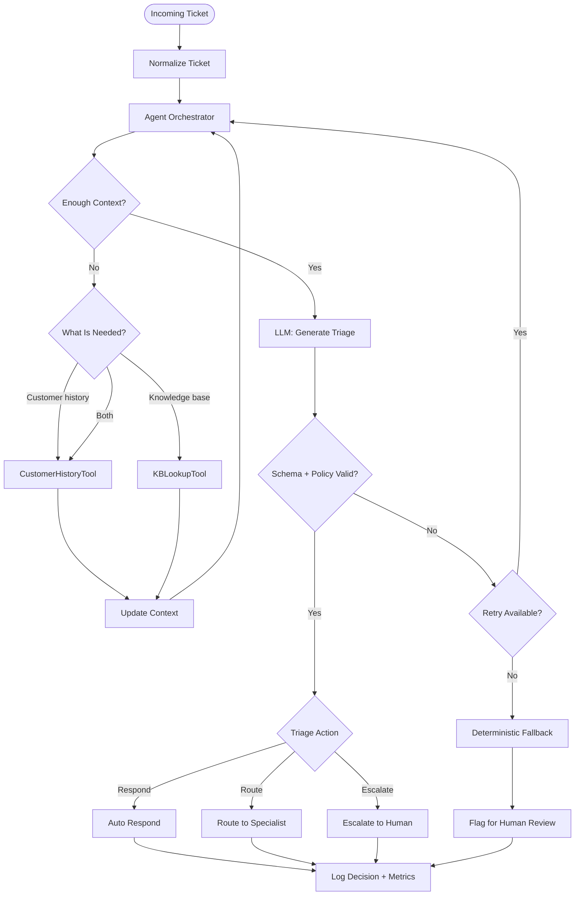

# Support Triage Agent

A production-friendly support triage agent with deterministic guardrails, schema validation, live/offline LLM support, evaluation tooling, and a JSON-first CLI.

## Table of contents

- [Features](#features)
- [Installation](#installation)
- [Running the CLI](#running-the-cli)
- [Testing](#testing)
- [Evaluation](#evaluation)
- [Docker](#docker)
- [Command reference](#command-reference)
- [Project Structure](#project-structure)
- [Notes](#notes)

## Features

- Accepts support tickets as JSON from a string or a file
- Classifies urgency as low, medium, high, or critical
- Extracts structured metadata: product, issue type, sentiment, language, and intents
- Uses customer-history and knowledge-base tools before making a decision
- Applies deterministic policy guardrails before accepting any output
- Validates model output against a strict JSON schema
- Supports both live OpenAI mode and offline/mock mode for CI and testing
- Falls back safely when tooling, parsing, or LLM output fails
- Includes evaluation scripts and unit tests for quality and reliability

## Installation

1. Clone or open the project directory.
2. Create and activate a virtual environment (optional but recommended):

   Windows PowerShell:
   ```powershell
   python -m venv .venv
   .\.venv\Scripts\Activate.ps1
   ```

   macOS/Linux:
   ```bash
   python3 -m venv .venv
   source .venv/bin/activate
   ```

3. Install the app and dev dependencies:

   ```bash
   python -m pip install --upgrade pip
   python -m pip install -e .
   python -m pip install pytest
   ```

4. Optional: set a live OpenAI key for live mode (only needed for `--mode live`):

   PowerShell:
   ```powershell
   $env:OPENAI_API_KEY = "your-key-here"
   ```

   macOS/Linux:
   ```bash
   export OPENAI_API_KEY=your-key-here
   ```

## Running the CLI

Run triage from the project root. Use the command reference below for common examples. Example quick run (offline):

```bash
python -m app.cli.main --ticket-file tickets/sample_ticket.json --mode offline
```

Flags:

- `--pretty` prints formatted JSON
- `--mode offline` uses the embedded deterministic mock
- `--mode live` uses OpenAI (requires API key)
- `--model` overrides the live model name

## Testing

Run the full suite:

```bash
python -m pytest -q
```

## Guardrails

| Guardrail ID | Trigger Condition | Action when activated | Notes |
|---|---|---|---|
| billing_no_auto | Issue type or customer history indicates billing dispute, chargeback, or unresolved payments | Block auto_respond; prefer route_to_specialist or escalate_to_human; flag for human review | Prevents transactional/legal auto-replies |
| sec_escalate | Mentions security, breach, data loss, legal threat, or lawsuit in issue_type, reasoning, or intents | Prevent auto_respond; escalate_to_human and set urgency >= high | Rapid human/security triage required |
| no_promises | Draft or reasoning contains refund, compensation, ETA, or commitment language | Hold reply for human review; replace auto-respond draft | Avoid unauthorized commitments |
| enterprise_outage_escalate | Product indicates enterprise customer and issue mentions outage/down/service unavailable | Escalate_to_human; set urgency = critical | SLA/customer-impact escalation |
| prompt_injection_escalate | Reasoning or safety_checks indicate instruction-bypass, prompt injection, or malicious input | Discard generated draft; escalate_to_human; flag security | Treat as potentially malicious input |
| draft_language_matches | Safety_checks report language_mismatch between ticket and draft | Replace draft and route to human/specialist review | Ensure reply language correctness |
| ungrounded_auto_respond | Auto_respond attempted without KB evidence or KB indicates no matches | Prevent auto_respond; route_to_specialist | Auto replies must be grounded in KB |
| low_confidence_escalate | Model confidence below configured threshold (default 0.75) | Prevent auto_respond; route_to_specialist or escalate_to_human | Threshold configurable (MIN_CONF_AUTO) |
| action_matches_intents | Identified intents explicitly request human/specialist/escalation | Prevent auto_respond; route or escalate accordingly | Intent-driven safety override |

Notes:
- Actions are conservative by design: guardrails block unsafe auto-responses and prefer routing or human escalation.
- Update policy logic in app/guardrails/policy.py and corresponding tests in tests/test_guardrails_extended.py if changing IDs or actions.

Run a specific test file or single test using pytest as usual.

## Evaluation

Evaluate predicted triage labels against gold labels (see `eval/sample_eval.json` for format):

```bash
python -m eval.run_eval --file eval/sample_eval.json
```

Metrics returned:

- `urgency_accuracy`
- `action_accuracy`
- `overall_accuracy`

## Docker

There is a Dockerfile and a docker-compose.yml for containerized runs. Use the Dockerfile for single runs or CI; use docker-compose for convenient development.

Build the image:

```bash
docker build -t support-triage-agent .
```

Run offline (mount tickets folder):

```bash
docker run --rm -v "${PWD}/tickets:/app/tickets:ro" support-triage-agent --ticket-file /app/tickets/sample_ticket.json --mode offline
```

Run live (provide API key):

```bash
docker run --rm -e OPENAI_API_KEY=$OPENAI_API_KEY -v "${PWD}/tickets:/app/tickets:ro" support-triage-agent --ticket-file /app/tickets/sample_ticket.json --mode live
```

docker-compose quick start (build + run default):

```bash
docker compose up --build
```

Override compose command for ad-hoc runs:

```bash
docker compose run --rm triage -- --ticket-file /app/tickets/other_ticket.json --mode offline
```

## Command reference

| Command | What it does | Example |
|---|---|---|
| Run CLI (offline) | Run triage on a ticket file using the deterministic local mock LLM | `python -m app.cli.main --ticket-file tickets/sample_ticket.json --mode offline` |
| Run CLI (live) | Run triage using OpenAI (requires OPENAI_API_KEY) | `python -m app.cli.main --ticket-file tickets/sample_ticket.json --mode live` |
| Install deps | Install package and dev/test tools locally | `python -m pip install -e . && python -m pip install pytest` |
| Run tests | Execute unit test suite | `python -m pytest -q` |
| Eval metrics | Compute urgency/action accuracy from predictions vs gold | `python -m eval.run_eval --file eval/sample_eval.json` |
| Docker build | Build the container image from Dockerfile | `docker build -t support-triage-agent .` |
| Docker run (offline) | Run the image, mount tickets, run offline triage | `docker run --rm -v "${PWD}/tickets:/app/tickets:ro" support-triage-agent --ticket-file /app/tickets/sample_ticket.json --mode offline` |
| Docker run (live) | Run image with OPENAI_API_KEY to execute live mode | `docker run --rm -e OPENAI_API_KEY=$OPENAI_API_KEY -v "${PWD}/tickets:/app/tickets:ro" support-triage-agent --ticket-file /app/tickets/sample_ticket.json --mode live` |
| Docker Compose up | Build and run the `triage` service (default offline sample) | `docker compose up --build` |
| Docker Compose run (override) | Run one-off command inside service container | `docker compose run --rm triage -- --ticket-file /app/tickets/other_ticket.json --mode offline` |

## Project Structure

```text
app/
  agent/
  cli/
  eval/
  guardrails/
  llm/
  models/
  prompts/
  tools/

eval/
  run_eval.py
  sample_eval.json
tests/
```

## Agentic Workflow



## Notes

- The app validates every LLM response before it is accepted.
- Invalid or unsafe outputs trigger a safe fallback path instead of an unsafe action.
- The offline mode is deterministic and useful for local testing, CI, and reproducible eval runs.
- Keep the "Command reference" table as the single quick-reference; update it when commands change.

## Future Improvements & Limitations

- **Knowledge Retrieval:** Add semantic embeddings, vector search, and reranking to improve KB relevance and grounding.
- **Agent Orchestration:** Refine context-selection logic and tool-calling decisions to reduce unnecessary retrieval and latency.
- **Evaluation:** Expand the evaluation dataset and measure retrieval quality, hallucination rate, and guardrail effectiveness.
- **Production Readiness:** Add persistent decision storage, monitoring, and human feedback to improve reliability over time.
- **Limitations:** Offline mode uses a deterministic mock LLM; live performance depends on model quality, KB coverage, and external tool availability.